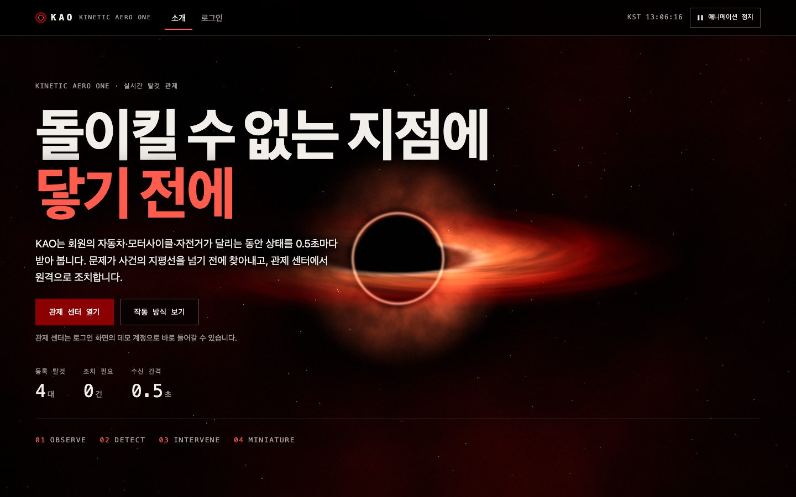
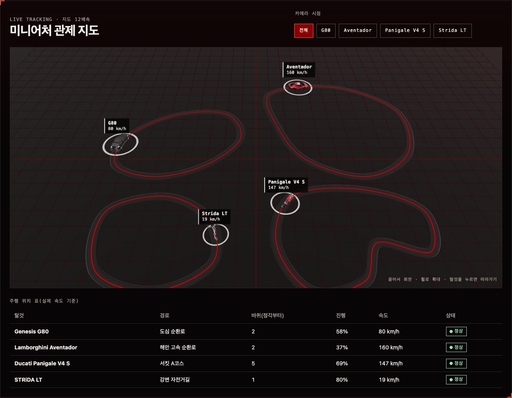
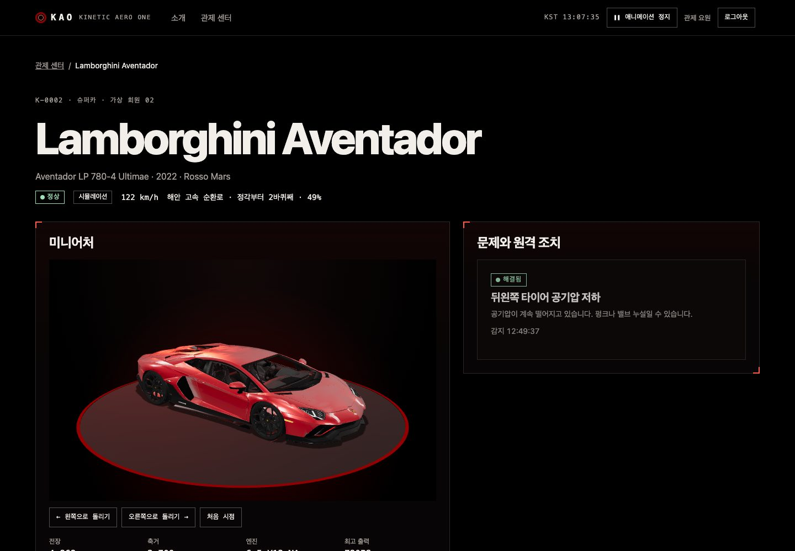
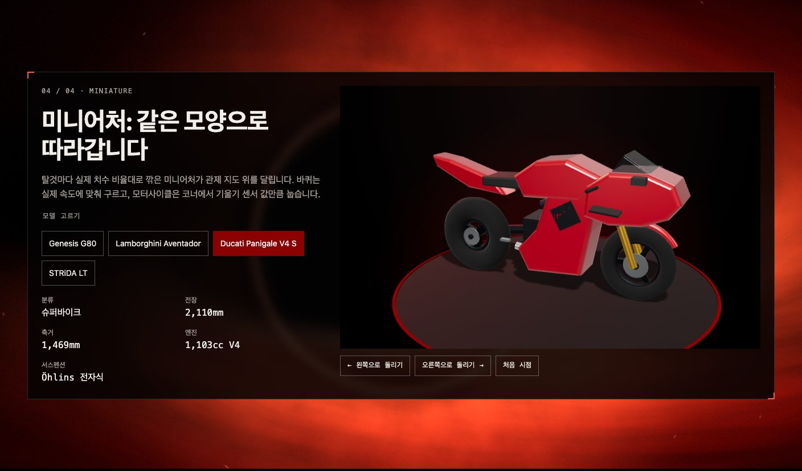
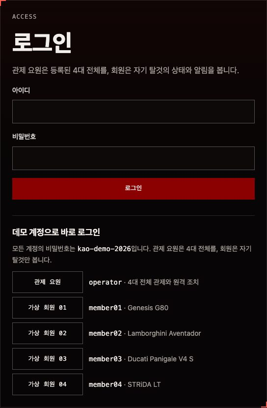
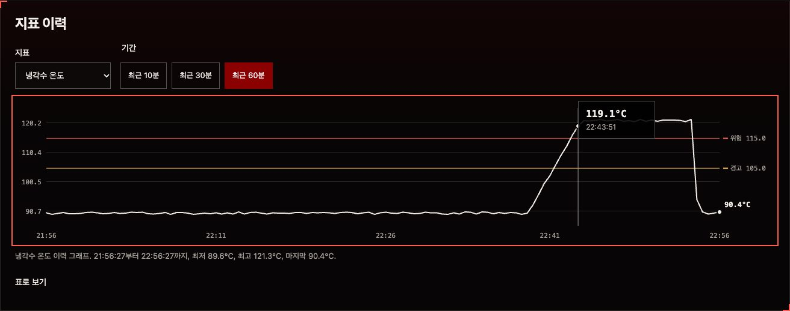
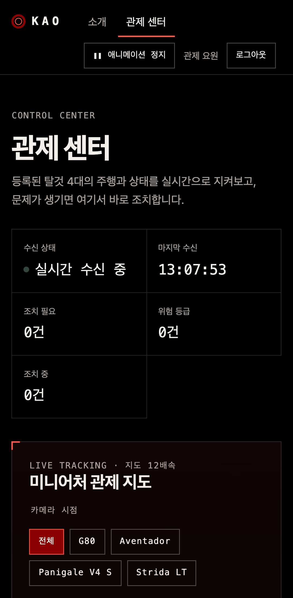

# KAO — Kinetic Aero One

[](https://github.com/ryushin01/kao/actions/workflows/ci.yml)


회원의 자동차·모터사이클·자전거가 달리는 동안 상태를 실시간으로 지켜보고, 문제가 생기면 원격으로 조치하는 관제 서비스입니다. 등록된 탈것은 실제 모양을 본뜬 3D 미니어처로 지도 위를 달립니다.

**[데모 바로 보기](https://kao-ryushin01.vercel.app/)** · 로그인 화면에서 데모 계정 버튼(관제 요원, 회원 01~04)을 누르면 됩니다. 비밀번호는 모두 `kao-demo-2026`입니다.

> **프로젝트 상태:** 포트폴리오 프로젝트입니다. 실제 차량 대신 서버의 주행 시뮬레이션이 데이터를 만들며(실측값 수신 API는 있음), 회원·등록번호·주행 기록은 모두 가상 데이터입니다.

## 화면

| 소개 | 관제 센터 |
|---|---|
|  |  |

| 탈것 상세 | 미니어처 |
|---|---|
|  |  |

| 로그인 | 지표 이력 |
|---|---|
|  |  |

| 모바일 관제 센터 |
|---|
|  |

## 주요 기능

| 화면 | 내용 |
|---|---|
| 소개 | 스크롤할수록 블랙홀(사건의 지평선)에 다가가는 WebGL 셰이더 배경, 관측·감지·조치·미니어처 4개 챕터 |
| 로그인 | 관제 요원은 4대 전체와 원격 조치, 회원은 자기 탈것만(조치 버튼 없이 상태 안내). 데모 계정 버튼 |
| 관제 센터 | SSE로 0.5초마다 받는 주행 데이터, 3D 미니어처 관제 지도(시점 고르기·따라가기), 주행 위치 표, 분류 필터, 위험 등급순 조치 대기열, 원격 조치 기록 |
| 탈것 상세 | 턴테이블 미니어처, 실시간 지표와 경고·위험 기준, 문제별 원격 조치, 지표 이력 그래프(10·30·60분), 경로 위치 |
| 위험 알림 | 위험 등급 문제를 웹 푸시로 알림(관제 요원은 전체, 회원은 자기 탈것) |

- **분류**: 세단·슈퍼카·슈퍼바이크·자전거 네 분류로 탈것을 나누고, 분류마다 대표 모델(G80, 아벤타도르, 파니갈레 V4 S, 스트라이다)을 3D 미니어처로 보여 줍니다. 같은 분류에 탈것이 늘어나도 `src/entities/vehicle/config/categories.ts` 하나로 관리합니다.
- **미니어처**: G80·아벤타도르·파니갈레는 실제 3D 모델(아래 출처)을 실제 치수와 방향으로 맞추고 바퀴를 분리해 썼고, STRiDA LT는 Three.js로 직접 모델링했습니다. 바퀴는 속도에 맞춰 구르고, 이륜차는 코너에서 기울기 값만큼 눕습니다. 도장 색은 회원 데이터대로 바뀝니다.
- **원격 조치**: 냉각 모드, 출력·속도 제한, TPMS 재보정, 트랙션 강화, 절전 모드, 운전자 알림, 긴급 출동. 확인 대화상자를 거치고 두 번 눌러도 한 번만 보냅니다.
- **서버리스 시뮬레이션**: 시뮬레이션은 시간의 순수 함수라 어느 서버 인스턴스든 같은 상태를 내고, 원격 조치만 DB에 저장합니다. 지표 이력도 지난 시각을 다시 계산해 그립니다. 실제 차량은 [수신 API](docs/integration.md)로 측정값을 보내면 그 값을 씁니다.
- **접근성**: 본문 바로가기, 애니메이션 정지(운영체제 '동작 줄이기' 따름), 색·모양·글자를 함께 쓰는 상태 표시, 새 문제를 `status`·`alert`로 알림, 3D 지도의 표 대체 콘텐츠

## 기술 스택


| 구분 | 사용 기술 |
|---|---|
| 프레임워크 | Nuxt 4, Vue 3, TypeScript 6 |
| 3D | Three.js(직접 모델링한 미니어처, GLSL 블랙홀 셰이더, OrbitControls) |
| 서버 | Nitro(h3) API, Server-Sent Events, 시간 기반 결정적 시뮬레이션, 서명 쿠키 로그인(scrypt) |
| 데이터·알림 | Neon(Postgres, `@neondatabase/serverless`), Web Push(`web-push`, 서비스 워커) |
| 구조 | Feature-Sliced Design v2.1, Steiger |
| 품질 | ESLint(@nuxt/eslint), Vitest + Vue Test Utils(happy-dom), Storybook 10, Playwright + axe |
| 배포·CI | Vercel(싱가포르 함수), GitHub Actions(CI, 5분 알림 검사) |

## 시작하기

Node.js 24(`.nvmrc`)와 pnpm 12가 필요합니다.

```bash
corepack enable pnpm
pnpm install
pnpm dev        # http://localhost:3000
```

| 명령 | 설명 |
|---|---|
| `pnpm build` / `pnpm preview` | 프로덕션 빌드 / 빌드 결과 실행 |
| `pnpm lint` / `pnpm lint:fsd` / `pnpm typecheck` | ESLint / Steiger(FSD) / 타입 검사 |
| `pnpm test` | 단위·컴포넌트 테스트 |
| `pnpm test:e2e` | 프로덕션 빌드의 E2E·접근성 검사 (먼저 `build` 필요) |
| `pnpm storybook` | Storybook (`http://localhost:6006`) |
| `pnpm db:migrate` | `DATABASE_URL`이 있으면 스키마 적용·데모 계정 맞추기 |
| `pnpm build:models` | `assets-src/`의 Sketchfab 원본을 `public/models/*.glb`로 변환 |

## 프로젝트 구조

```
app/              Nuxt 라우트·진입점 (src를 다시 내보내기만 함)
server/           Nitro API, 시간 기반 시뮬레이션(sim/), 저장소(store/), DB 스키마(db/)
scripts/          3D 모델 변환 스크립트
public/models/    변환한 3D 모델(GLB)
src/
├─ app/           진입 컴포넌트, 전역 스타일
├─ pages/         소개, 관제 센터, 탈것 상세, 오류
├─ widgets/       관제 지도, 미니어처 전시, 블랙홀 배경, 헤더 등
├─ features/      원격 조치, 로그인
├─ entities/      탈것(미니어처 3D 모델, 실시간 스트림, 지표 UI), 세션
└─ shared/        API 계약, 경로 좌표, Three.js 무대, 기본 UI
tests/e2e/        Playwright E2E
```

## 출처

| 모델 | 원작자 | 라이선스 |
|---|---|---|
| [Genesis G80](https://sketchfab.com/3d-models/genesis-g80-e9abf10cfee04ea480951d3c2f71f060) | [Nieve5677](https://sketchfab.com/niev) | [CC BY 4.0](https://creativecommons.org/licenses/by/4.0/) |
| [2022 Lamborghini Aventador LP780-4 Ultimae](https://sketchfab.com/3d-models/2022-lamborghini-aventador-lp780-4-ultimae-714a8795e58442258f96bd364b9096b1) | [Ddiaz Design](https://sketchfab.com/ddiaz-design) | [CC BY 4.0](https://creativecommons.org/licenses/by/4.0/) |
| [Ducati Panigale V4](https://sketchfab.com/3d-models/ducati-panigale-v4-47f87e3d70f644289e34cbff91255d0c) | [ROY](https://sketchfab.com/roy.gearloft.in) | [CC BY 4.0](https://creativecommons.org/licenses/by/4.0/) |

크기·방향 조정, 바퀴 분리, 도장 색 변경, 압축을 거쳤습니다. STRiDA LT 미니어처는 Three.js 코드로 직접 만들었고, 사이트 바닥글의 '3D 모델 출처' 링크가 이 표로 옵니다.

## 문서

| 문서 | 내용 |
|---|---|
| [개발 가이드](docs/development.md) | 구조, API와 시뮬레이션, 로그인, 미니어처 모델링, 테스트, CI |
| [배포](docs/deploy.md) | Vercel·Neon 구성, 환경 변수, 웹 푸시, 서버리스에서 상태 다루기 |
| [실차 연결](docs/integration.md) | 측정값 수신 API, 화면 반영 방식, 남은 과제 |
| [버전 기록](CHANGELOG.md) | 버전별 변경 내용 |
