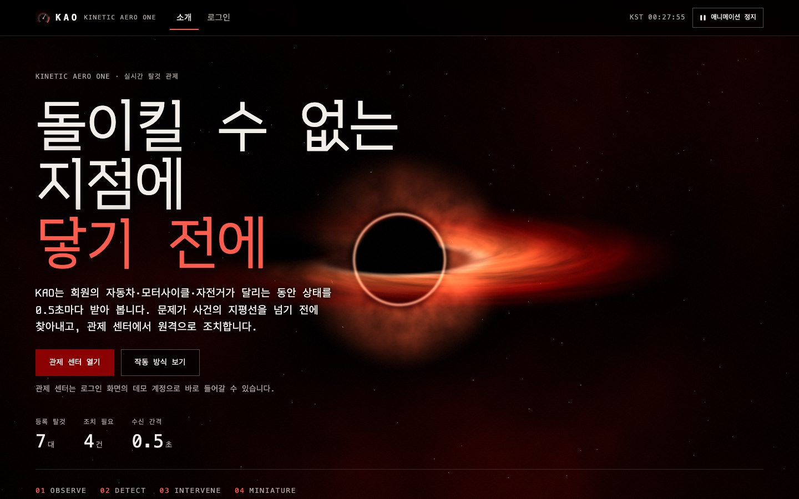
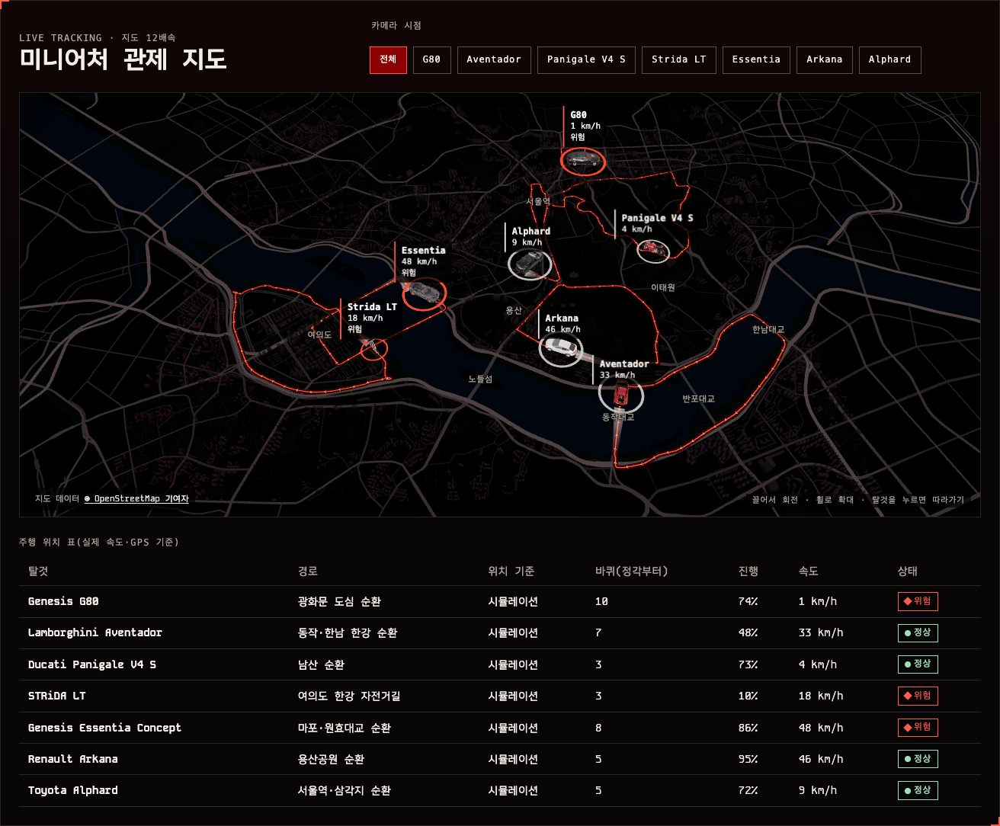
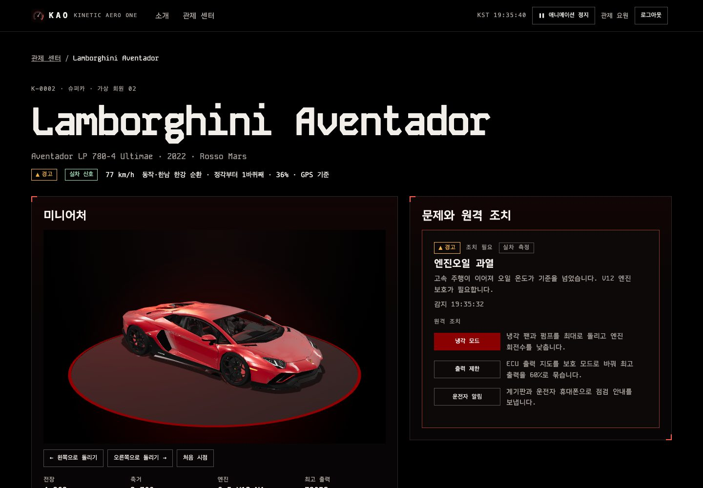
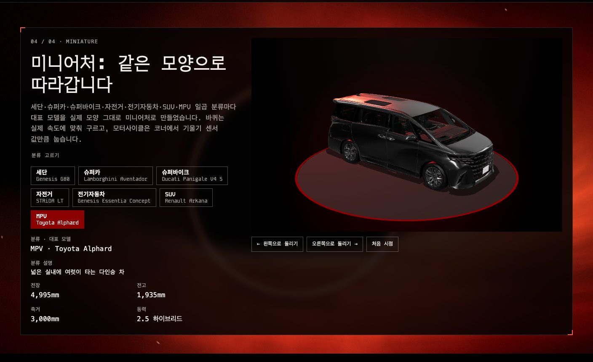
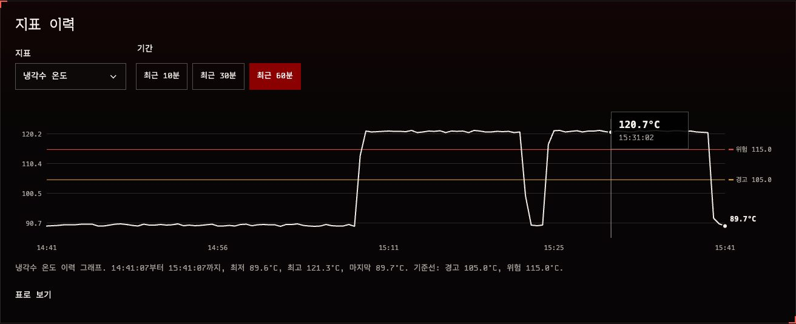
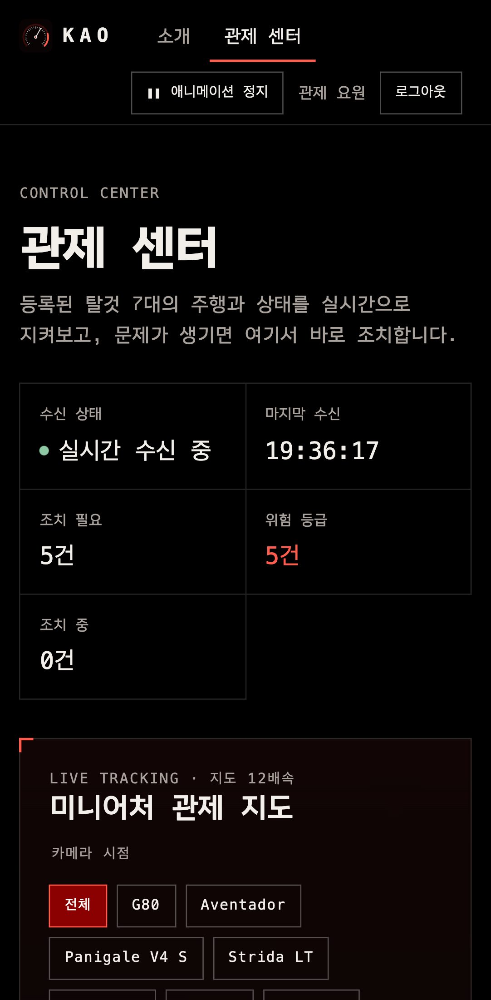

# KAO — Kinetic Aero One

[](https://github.com/ryushin01/kao/actions/workflows/ci.yml)


회원의 자동차·모터사이클·자전거가 달리는 동안 상태를 실시간으로 지켜보고, 문제가 생기면 원격으로 조치하는 관제 서비스입니다. 등록된 탈것은 실제 모양을 본뜬 3D 미니어처로 서울 도심 지도의 실제 도로 위를 달립니다.

**[데모 바로 보기](https://kao-ryushin01.vercel.app/)** · 로그인 화면에서 데모 계정 버튼(관제 요원, 회원 01~07)을 누르면 됩니다. 비밀번호는 모두 `kao-demo-2026`입니다.

> **프로젝트 상태:** 1.1.0. 런칭을 가정해 보안·실시간 안정성·성능·웹 앱·오프라인을 다듬은 포트폴리오 프로젝트입니다. 실제 차량 대신 서버의 주행 시뮬레이션이 데이터를 만들고, 실제 차량은 [실차 연결 API](docs/integration.md)로 붙일 수 있습니다(데모 장치 스크립트로 시험). 회원·등록번호·주행 기록은 모두 가상 데이터입니다.

## 화면

| 소개 | 관제 센터 |
|---|---|
|  |  |

| 탈것 상세 | 미니어처 |
|---|---|
|  |  |

| 지표 이력 | 모바일 관제 센터 |
|---|---|
|  |  |

## 주요 기능

| 화면 | 내용 |
|---|---|
| 소개 | 스크롤할수록 블랙홀(사건의 지평선)에 다가가는 WebGL 셰이더 배경, 관측·감지·조치·미니어처 4개 챕터 |
| 로그인 | 관제 요원은 7대 전체와 원격 조치, 회원은 자기 탈것만(조치 버튼 없이 상태 안내). 데모 계정 버튼 |
| 관제 센터 | SSE로 0.5초마다 받는 주행 데이터, 서울 도심 3D 관제 지도(실제 도로·한강·높은 건물, 시점 고르기·따라가기, 진행 방향·주행 꼬리), 주행 위치 표, 분류 필터, 위험 등급순 조치 대기열, 원격 조치 기록 |
| 탈것 상세 | 턴테이블 미니어처, 실시간 지표와 경고·위험 기준, 문제별 원격 조치, 지표 이력 그래프(10·30·60분), 경로 위치 |
| 위험 알림 | 위험 등급 문제를 웹 푸시로 알림(관제 요원은 전체, 회원은 자기 탈것). Cloudflare Workers 크론이 5분마다 검사. 홈 화면에 추가하면 웹 앱으로 열리고 iPhone도 알림을 받음 |

- **서울 지도**: OpenStreetMap 도로·한강·공원·지상 철도와 높은 건물(10층 이상 5,071동, 경로 주변은 6층 이상까지)로 광화문에서 여의도·반포까지를 3D로 그립니다. 분류마다 한 대씩 일곱 대가 도로 이름·진행 방향을 지정한 경유점을 일방통행을 지키며 잇는 실제 도로(G80 광화문 도심, 아벤타도르 한강 다리, 파니갈레 남산, 스트라이다 여의도 자전거길, 에센시아 마포·원효대교, 아르카나 용산공원 둘레, 알파드 서울역·삼각지)를 구간별 제한속도에 맞춰 달리고, 굽이에서 줄이고 신호에서 섭니다.
- **미니어처**: 세단·슈퍼카·슈퍼바이크·자전거·전기자동차·SUV·MPV 일곱 분류의 대표 모델입니다. G80·아벤타도르·파니갈레·에센시아·아르카나·알파드는 실제 3D 모델(아래 출처)을 실제 치수로 맞추고 바퀴를 분리했고, STRiDA LT는 Three.js로 직접 모델링했습니다. 바퀴는 속도에 맞춰 구르고, 이륜차는 굽은 길에서 실제 속도에 맞는 각도로 눕습니다.
- **원격 조치·실차 연결**: 냉각 모드, 출력·속도 제한, TPMS 재보정 등을 확인 대화상자를 거쳐 한 번만 보냅니다. 실제 차량이 측정값·GPS를 보내면 실측값으로 바뀌고, 조치는 명령으로 차량에 전달돼 적용·실패 응답을 받습니다. 장치는 탈것 하나에 묶인 토큰을 쓰고, 제조사 서버에는 서명한 웹훅으로 명령을 보내며, 경로 밖을 달리면 실제 위치와 지나온 길을 그리고 300m를 넘으면 '경로 이탈' 문제를 엽니다([실차 연결](docs/integration.md)).
- **서버리스·성능**: 시뮬레이션은 시간의 순수 함수라 어느 서버 인스턴스든 같은 상태를 냅니다. 실시간 스트림은 gzip으로 보내(초당 약 0.6 KB) 끊기면 다시 연결하고 숨긴 탭에서는 멈춥니다. 3D는 화면에 다가올 때 받고, 지도 도형은 웹 워커에서 만들며, 셰이더는 그리기 전에 메인 스레드를 막지 않게 컴파일합니다.
- **오프라인**: 한 번 연 화면은 인터넷이 끊겨도 이 기기에 저장해 둔 화면과 서울 지도·3D 모델·글꼴로 엽니다(실시간 위치와 원격 조치는 다시 연결되면 이어짐). 저장하지 않은 화면은 저장된 화면 목록을 안내하고, 로그인해야 보이는 화면의 저장본은 로그아웃하면 지웁니다. 로컬로 띄운 KAO는 외부에서 받는 것이 없어 처음부터 인터넷 없이 돕니다([개발 가이드](docs/development.md#오프라인)).
- **접근성**: 본문 바로가기, 애니메이션 정지(운영체제 '동작 줄이기' 따름), 색·모양·글자를 함께 쓰는 상태 표시, 새 문제를 `status`·`alert`로 알림, 3D 지도의 표 대체 콘텐츠

## 기술 스택


| 구분 | 사용 기술 |
|---|---|
| 프레임워크 | Nuxt 4, Vue 3, TypeScript 6 |
| 3D | Three.js(직접 모델링한 미니어처, GLSL 블랙홀 셰이더, OrbitControls) |
| 서버 | Nitro(h3) API, Server-Sent Events(gzip), 시간 기반 결정적 시뮬레이션, 서버 세션 로그인(scrypt, 시도 제한), 보안 헤더 |
| 데이터·알림 | Neon(Postgres, `@neondatabase/serverless`), Web Push(`web-push`, 서비스 워커) |
| 구조·품질 | Feature-Sliced Design v2.1(Steiger), ESLint(@nuxt/eslint), Vitest + Vue Test Utils(happy-dom), Storybook 10, Playwright + axe |
| 배포·CI | Vercel(싱가포르 함수), Cloudflare Workers(5분 위험 알림 크론), GitHub Actions(CI) |

## 시작하기

Node.js 24(`.nvmrc`)와 pnpm 12가 필요합니다.

```bash
corepack enable pnpm
pnpm install
pnpm dev        # http://localhost:3000
```

| 명령 | 설명 |
|---|---|
| `pnpm build` / `pnpm preview` | 프로덕션 빌드 / 빌드 결과 실행 |
| `pnpm lint` / `pnpm lint:fsd` / `pnpm typecheck` | ESLint / Steiger(FSD) / 타입 검사 |
| `pnpm test` / `pnpm test:e2e` | 단위·컴포넌트 테스트 / 프로덕션 빌드의 E2E·접근성 검사(먼저 `build`) |
| `pnpm screenshots` | README 화면 다시 찍기 (먼저 `pnpm build`, 실제 3D 모델과 실차 신호 흉내로 찍음) |

3D 모델·서울 지도 만들기, 실차 데모 장치, DB 마이그레이션, Storybook 명령은 [개발 가이드](docs/development.md#명령)에 있습니다.

### 인터넷 없이 띄우기

서울 지도 데이터(OpenStreetMap)·3D 모델·글꼴은 저장소에 들어 있고, 화면을 열 때 외부에서 받는 것이 없습니다. 인터넷이 될 때 `pnpm install`과 `pnpm build`를 해 두면 오프라인에서도 `pnpm preview`로 띄운 `http://localhost:3000`을 그대로 쓸 수 있습니다. `DATABASE_URL`을 비워 두면 메모리 저장소와 데모 계정(`operator` / `kao-demo-2026`)·주행 시뮬레이션으로 돕니다. 인터넷이 있어야 하는 것과 외부 요청이 없음을 확인한 방법은 [개발 가이드](docs/development.md#인터넷-없이-내-컴퓨터에서-띄우기)에 있습니다.

## 프로젝트 구조

```
app/        Nuxt 라우트·진입점 (src를 다시 내보내기만 함)
server/     Nitro API, 시뮬레이션·실차 연동(sim/), 저장소(store/), DB 스키마(db/)
scripts/    3D 모델 변환, 서울 지도 만들기, DB 마이그레이션, 실차 데모 장치
workers/    5분 위험 알림 크론(Cloudflare Workers)
public/     3D 모델(models/)과 서울 지도 데이터(maps/)
src/        FSD 계층: pages(소개·관제 센터·탈것 상세), widgets(관제 지도·미니어처 전시·블랙홀 배경),
            features(원격 조치·로그인), entities(탈것·세션), shared(API 계약·경로 좌표·Three.js 무대·기본 UI)
tests/e2e/  Playwright E2E
```

## 웹 폰트

| 글꼴 | 쓰는 곳 | 굵기 | 저작자 | 라이선스 | 원본 |
|---|---|---|---|---|---|
| Kode Mono | 영문·숫자 (제목·본문) | 400~700 가변 | Isa Ozler | SIL OFL 1.1 | [Google Fonts](https://fonts.google.com/specimen/Kode+Mono) · [Fontsource](https://fontsource.org/fonts/kode-mono) |
| 스포카 한 산스 네오 (줄인 판 이름 KaoSans) | 한글 본문 | 400·500·700 | Spoqa | SIL OFL 1.1 (예약 이름 Spoqa Han Sans Neo) | [GitHub spoqa/spoqa-han-sans](https://github.com/spoqa/spoqa-han-sans) |
| 오빗 (Orbit) | 한글 제목 (h1·h2) | 400 | 조수운·JAMO | SIL OFL 1.1 | [Google Fonts](https://fonts.google.com/specimen/Orbit) · [google/fonts](https://github.com/google/fonts/tree/main/ofl/orbit) |

모두 같은 사이트에서 제공합니다(외부 글꼴 CDN 없음). 한글 두 글꼴은 화면에 쓰는 글자만 담은 파일을 먼저 받고, 나머지 글자 조각(`public/fonts`)은 페이지를 다 받은 뒤 붙입니다(`pnpm fonts`로 만듦, 원본과 라이선스 전문은 `scripts/fonts/`. 이름 바꾸기에 Python `fontTools`가 필요: `pip install fonttools brotli`). 스포카 한 산스 네오는 OFL 예약 이름이 있어 줄인 파일의 이름을 KaoSans로 바꿨습니다. 오빗에는 h1·h2 제목에 쓰는 글자만 미리 담고(`scripts/fonts/titles.mjs`), 자주 쓰는 한글 2,780자만 들어 있어 그 밖의 드문 글자는 KaoSans로 보입니다.

## 출처

| 자료 | 원작자 | 라이선스 |
|---|---|---|
| [Genesis G80](https://sketchfab.com/3d-models/genesis-g80-e9abf10cfee04ea480951d3c2f71f060) | [Nieve5677](https://sketchfab.com/niev) | [CC BY 4.0](https://creativecommons.org/licenses/by/4.0/) |
| [2022 Lamborghini Aventador LP780-4 Ultimae](https://sketchfab.com/3d-models/2022-lamborghini-aventador-lp780-4-ultimae-714a8795e58442258f96bd364b9096b1) | [Ddiaz Design](https://sketchfab.com/ddiaz-design) | [CC BY 4.0](https://creativecommons.org/licenses/by/4.0/) |
| [Ducati Panigale V4](https://sketchfab.com/3d-models/ducati-panigale-v4-47f87e3d70f644289e34cbff91255d0c) | [ROY](https://sketchfab.com/roy.gearloft.in) | [CC BY 4.0](https://creativecommons.org/licenses/by/4.0/) |
| [2018 Genesis Essentia Concept](https://sketchfab.com/3d-models/2018-genesis-essentia-concept-da53b2c73baa426bb58d576c00b32ef1) | [kevin (ケビン)](https://sketchfab.com/sohyalebret) | [CC BY 4.0](https://creativecommons.org/licenses/by/4.0/) |
| [2019 Renault Arkana](https://sketchfab.com/3d-models/2019-renault-arkana-b28e3bd3a038423b9d1a5c27cc45087f) | [tonielpro520](https://sketchfab.com/tonielpro520) | [CC BY 4.0](https://creativecommons.org/licenses/by/4.0/) |
| [Toyota Alphard (2025)](https://sketchfab.com/3d-models/toyota-alphard-2025-22ff91c22fd84ef68384a8fa388b88d6) | [geyges](https://sketchfab.com/geyges) | [Sketchfab Standard](https://sketchfab.com/licenses) |
| 서울 지도 데이터(도로·한강·공원·건물) | [© OpenStreetMap 기여자](https://www.openstreetmap.org/copyright) | [ODbL 1.0](https://opendatacommons.org/licenses/odbl/1-0/) |

3D 모델은 크기·방향 조정, 바퀴 분리, 도장 색 변경(알파드는 검정), 단순화, 압축을 거쳤습니다. 아르카나는 원본에 없는 앞 왼쪽 바퀴를 반대쪽 바퀴로 채웠고, 에센시아는 흰 반투명 유리를 짙은 유리로 바꿨습니다. STRiDA LT 미니어처는 Three.js 코드로 직접 만들었습니다. 지도 데이터는 Overpass API로 받아 간추리고 그 도로로 주행 경로를 만들었습니다(`public/maps/seoul.json`, `src/shared/config/routes.ts`도 ODbL을 따릅니다). 사이트 바닥글의 '3D 모델·지도 데이터 출처' 링크가 이 표로 오고, 지도 데이터는 OpenStreetMap 재단의 출처 표시 지침대로 관제 지도 왼쪽 아래에도 '© OpenStreetMap 기여자'를 띄웁니다.

## 문서

| 문서 | 내용 |
|---|---|
| [개발 가이드](docs/development.md) | 구조, API와 시뮬레이션, 로그인, 서울 지도, 미니어처 모델링, 오프라인, 테스트, CI |
| [배포](docs/deploy.md) | Vercel·Neon 구성, 환경 변수, 웹 푸시, 서버리스에서 상태 다루기 |
| [실차 연결](docs/integration.md) | 측정값·GPS 수신, 실측 문제, 원격 조치 명령과 응답, 데모 장치 |
| [버전 기록](CHANGELOG.md) | 버전별 변경 내용 |
