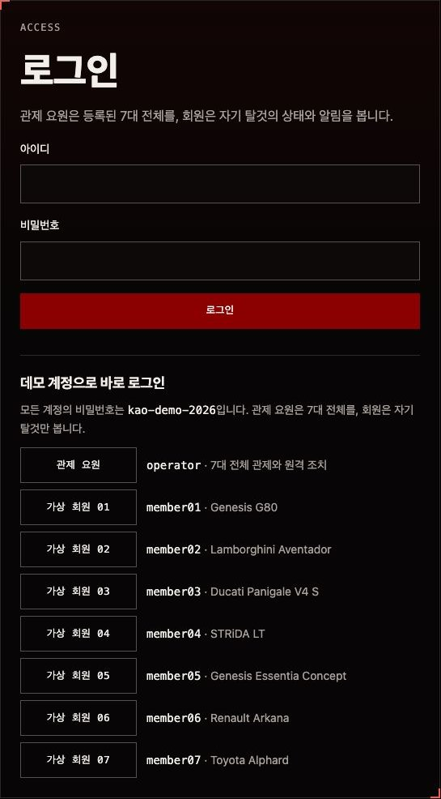

# 개발 가이드

## 구조

Nuxt 4의 `app/` 폴더는 라우트와 진입점만 둡니다. 화면 코드는 모두 `src/`에 [Feature-Sliced Design v2.1](https://feature-sliced.design) 계층으로 나눕니다.

| 위치 | 역할 |
|---|---|
| `app/app.vue`, `app/error.vue` | `@app`, `@pages/not-found`를 그리기만 합니다 |
| `app/pages/**.ts` | `src/pages`의 페이지 컴포넌트를 다시 내보내기만 합니다 |
| `src/app` | 진입 컴포넌트(`entrypoint`)와 전역 스타일(`styles`) |
| `src/pages` | 소개(`home`), 관제 센터(`fleet`), 탈것 상세(`vehicle`), 오류(`not-found`) |
| `src/widgets` | 헤더, 푸터, 블랙홀 배경, 관제 지도, 미니어처 전시, 조치 기록, 화면 낭독기 알림 |
| `src/features/remote-action` | 원격 조치 확인과 전송 |
| `src/entities/vehicle` | 모델 제원, 미니어처 3D 모델, 실시간 스트림, 지표·카드 UI |
| `src/shared` | API 계약과 요청(`api`), 경로 좌표(`config`), 포맷·모션·Three.js 무대(`lib`), 기본 UI(`ui`) |
| `server/` | Nitro API와 주행 시뮬레이션 |

- 슬라이스는 공개 API(`index.ts`)로만 가져옵니다. 별칭은 `@app`, `@pages`, `@widgets`, `@features`, `@entities`, `@shared`입니다.
- Nuxt의 자동 가져오기는 끄고(`imports.autoImport: false`) `vue`, `#imports`, `#components`에서 직접 가져옵니다. 그래서 컴포넌트를 Storybook과 Vitest에서 Nuxt 없이 그릴 수 있습니다.
- `pnpm lint:fsd`(Steiger)로 계층 규칙을 검사합니다.

## 서버와 시뮬레이션

| 경로 | 권한 | 내용 |
|---|---|---|
| `GET /api/showroom` | 공개 | 소개 화면용 모델·도장·열린 문제 수(위치·회원 정보 제외) |
| `POST /api/auth/login`, `POST /api/auth/logout`, `GET /api/auth/session` | 공개 | 로그인(서명 쿠키 `kao_session`, 7일), 로그아웃, 현재 사용자와 웹 푸시 공개 키 |
| `GET /api/fleet` | 로그인 | 볼 수 있는 탈것의 현재 프레임 |
| `GET /api/fleet/stream` | 로그인 | 0.5초마다 프레임을 보내는 SSE. 50초마다 닫고 다시 연결 |
| `POST /api/vehicles/:id/actions` | 관제 요원 | `{ issueId, action }`. 맞지 않는 조치 422, 이미 조치 중 409 |
| `GET /api/vehicles/:id/history?metric=&minutes=` | 로그인(볼 수 있는 탈것) | 10·30·60분 지표 이력 120점 |
| `POST/DELETE /api/push/subscriptions`, `POST /api/push/test` | 로그인 | 웹 푸시 구독·해지, 시험 알림 |
| `GET /api/cron/notify` | `CRON_SECRET` | 위험 등급 문제 웹 푸시 |
| `POST /api/ingest/telemetry` | 장치 토큰·`INGEST_TOKEN` | 실차 측정값·GPS 수신. 응답에 차량이 받아 갈 명령([실차 연결](integration.md)) |
| `GET /api/ingest/commands?vehicleId=` | 장치 토큰·`INGEST_TOKEN` | 차량이 아직 응답하지 않은 원격 조치 명령 |
| `POST /api/ingest/commands/:id/ack` | 장치 토큰·`INGEST_TOKEN` | 명령 적용 결과 `{ vehicleId, result: applied \| failed, message? }` |

쿠키를 쓰는 변경 요청은 `Origin`이 같은 사이트일 때만 받습니다(SameSite=Lax에 더한 CSRF 방어).

### 시뮬레이션(`server/utils/sim/engine.ts`)

시간의 순수 함수입니다. 같은 시각과 같은 조치 기록이면 어느 서버에서든 같은 결과를 냅니다.

- **속도·위치**(`server/utils/sim/drive.ts`): 경로 위치마다 낼 수 있는 속도 표를 만듭니다. 구간별 제한속도(`routes.ts`의 `speedLimits`)와 탈것 최고 속도(`cruise`) 가운데 낮은 값에서, 굽이는 √(횡가속 × 반지름)까지 줄이고, 신호(`signals`)에서는 섭니다(신호마다 0~40초, 열에 셋은 녹색). 그 위에 가속·감속 한계(`handling`)를 지킵니다. 차는 이 표 × 교통 흐름 배수(`pace`, 사인파 둘의 합)로 달립니다. 배수의 적분(유효 시간)이 표로 만든 한 바퀴 시간표와 같으므로, 어느 시각이든 위치를 시간표에서 바로 찾습니다(서버리스에서도 시간의 순수 함수). 한 시간 평균은 G80 도심 20km/h(38% 정차), 아벤타도르 51km/h(최고 80), 파니갈레 남산 27km/h(32% 정차), 스트라이다 16.5km/h입니다. 속도 제한 조치는 평소 최고 속도의 60%(도심이면 30km/h), 출력 제한은 80%로 묶고, 걸린 90초는 제한 때문에 덜 간 만큼을 수치 적분으로 뺍니다(겹치면 더 낮은 제한). 바퀴 수(`lap`, 매시 정각부터)와 진행률(`progress`)은 실제로 달린 위치입니다. 관제 지도 위치(`mapProgress`)는 유효 시간을 12배(`TIME_SCALE`) 한 위치라, 실제로 한 바퀴를 돌면 지도에서는 정확히 12바퀴를 돌고 지도에서도 굽이·신호에서 느려집니다. 지도 위치의 속도(`mapSpeed`)를 따로 주어 지도는 그 12배로 내다봅니다. 화면의 카드·주행 위치 표·상세는 실제 속도 기준 값을 쓰고, 지도 제목에는 "지도 12배속"이라고 밝힙니다.
- **문제**: KST 0시부터 45초 칸마다 시드 난수로 후보를 뽑고, 같은 지표에 진행 중인 문제가 있거나 동시에 2건이면 건너뜁니다. 문제는 지표를 나쁜 쪽으로 천천히 밀고(경고 단계 2분 이상), 조치하면 멈춘 뒤 지수로 회복합니다. 조치가 없으면 15분 뒤 저절로 끝납니다. 문제 id는 `탈것-지표-날짜-칸`이라 조치 기록과 이어집니다.
- **이력**: 시뮬레이션은 지난 시각을 다시 계산하므로 따로 저장하지 않습니다. 실차 측정값이 있던 시각은 저장한 측정값을 씁니다.

### 실차 연동(`server/utils/sim/live.ts`, `server/utils/ingest.ts`)

30초 안에 측정값이 들어온 탈것은 시뮬레이션 대신 실측값·GPS·실측 문제를 씁니다. 시뮬레이션처럼 상태는 저장한 기록(측정값, 실측 문제, 명령과 차량 응답)만으로 계산하는 순수 함수(`live.ts`)이고, 수신 API(`ingest.ts`)가 측정값이 올 때마다 실측 문제를 열고·올리고·해결해 저장합니다. 늦게 도착한 측정값은 이력에만 저장하고, 겹친 요청은 문제의 `checked_at`(마지막으로 반영한 측정 시각)이 그대로일 때만 저장해 서로 덮어쓰지 않습니다. 0시 직전에 보낸 명령도 응답·회복을 기다리거나 그 명령으로 해결한 문제가 화면에 남아 있는 동안은 계속 보도록, 조치는 0시 32분 전부터 읽습니다. 원격 조치는 실측 문제면 명령으로 쌓였다가 차량이 받아 가 응답(applied·failed)하고, 2분 안에 응답이 없거나 실패하면 다시 조치할 수 있게 엽니다. 수신 API는 탈것 하나에 묶인 장치 토큰(`devices.ts`, DB에는 SHA-256만)이나 개발·시험용 공용 토큰(`INGEST_TOKEN`)으로 인증하고, 웹훅을 등록한 장치에는 명령을 서명해 바로 보냅니다(`webhook.ts`: https만, 내부망 주소 차단, 리다이렉트 없음, 5초). 규칙과 API 형식은 [실차 연결](integration.md)에 있습니다. 시뮬레이션의 위치·문제 일정은 실차 명령의 영향을 받지 않습니다.

### 저장소(`server/utils/store/`)

`DATABASE_URL`이 있으면 Neon(`postgres.ts`), 없으면 메모리(`memory.ts`)를 씁니다. 로컬 개발·테스트·미리보기 배포는 메모리 저장소이며 데모 계정이 들어 있습니다. 테이블은 계정(`users`), 원격 조치와 실차 명령 응답(`remote_actions`), 실측 문제(`live_issues`), 측정값·GPS(`telemetry_readings`, 하루 보관), 실차 장치(`devices`), 웹 푸시 구독·발송 기록입니다. 스키마는 `server/db/schema.sql`, 적용은 `pnpm db:migrate`([배포](deploy.md)).

### 로그인과 화면 접근

- 계정: 관제 요원(`operator`)과 회원(`member01`~`07`, 각자 탈것 하나). 비밀번호는 scrypt로 해시합니다. 데모 계정 목록은 `src/shared/api/contract.ts`의 `DEMO_ACCOUNTS`.
- 화면 접근은 전역 라우트 미들웨어(`src/app/routes/auth-guard.ts`)가 정합니다: `/fleet`은 관제 요원만(회원은 자기 탈것으로), `/fleet/:id`는 관제 요원이나 그 탈것의 회원만.
- API도 같은 규칙을 서버에서 다시 확인합니다(`server/utils/session.ts`).

## 탈것 분류

분류와 대표 모델은 `src/entities/vehicle/config/categories.ts`의 `VEHICLE_CATEGORIES`에 있습니다(세단 `sedan`, 슈퍼카 `supercar`, 슈퍼바이크 `superbike`, 자전거 `bicycle`, 전기자동차 `ev`, SUV `suv`, MPV `mpv`). 탈것의 분류는 서버 `fleet-specs.ts`의 `kind`로 정하고, 화면은 분류 이름을 `CATEGORY_LABELS`에서 가져옵니다. 소개 화면은 분류를 고르면 그 분류의 등록 탈것을 그 도장으로 턴테이블에 올리고, 관제 센터는 분류 필터로 아래 목록을 거릅니다. 턴테이블 카메라(`frameShowcase`)는 미니어처의 경계 구에 맞춰 거리를 잡고, 키가 큰 SUV·MPV처럼 턴테이블 앞쪽 가장자리가 화면 아래로 벗어나면 들어올 때까지 물러납니다.

분류마다 대표 모델의 등록 탈것이 한 대씩 있고, 모두 관제 지도의 실제 도로를 달립니다(7대). 분류를 더할 때는 아래를 함께 더합니다. `server/utils/fleet-specs.test.ts`가 분류마다 탈것·경로·회원 계정·지도용 모델이 있는지 확인합니다.

1. 분류·모델: `VehicleKind`·`VehicleModelId`(`src/shared/api/contract.ts`), `VEHICLE_CATEGORIES`, `MODEL_PROFILES`, 직접 만든 모형(`lib/miniatures`), 관제 지도의 미니어처 크기(`MINIATURE_LENGTH`)
2. 실제 3D 모델: `scripts/build-models.mjs`의 `MODELS`에 넣고 `pnpm build:models <id>`(원본 GLB와 지도용 `.lite.glb`), `MODEL_ASSETS`에 `url`·`liteUrl`
3. 경로: `scripts/build-seoul-map.mjs`의 `ROUTE_PLANS`에 넣고 `pnpm build:map`(탈것마다 다른 경로)
4. 탈것: `server/utils/fleet-specs.ts`의 `VEHICLE_SPECS`(경로, 도장, 순항 속도, 가감속, 지표와 문제)
5. 회원: `DEMO_MEMBERS`(`contract.ts`). 운영 DB에는 배포할 때 `scripts/migrate.mjs`가 넣습니다

## 서울 지도

관제 지도는 OpenStreetMap 서울 데이터(© OpenStreetMap 기여자, ODbL 1.0)로 그립니다. `pnpm build:map`(`scripts/build-seoul-map.mjs`)이 Overpass API에서 받은 원본(`assets-src/osm/`, 커밋하지 않음)으로 두 파일을 만듭니다. 없는 원본만 받고, `--fetch`면 모두 다시 받습니다. 공용 서버는 큰 요청을 502·504로 끊으므로 넓은 범위는 조각(2×2, 3×3)으로 나눠 받고 서버 세 곳을 돌아가며 다시 요청합니다.

| 결과 | 내용 |
|---|---|
| `src/shared/config/routes.ts` | 탈것마다의 주행 경로(위도·경도 닫힌 경로, 실제 길이, 구간별 제한속도, 신호 위치). 직접 고치지 않고 스크립트의 `ROUTE_PLANS`를 고친 뒤 다시 만듭니다 |
| `public/maps/seoul.json` | 도로·한강·공원·높은 건물(지도 중심 기준 m 정수 좌표를 앞 점과의 차이로 줄인 차분 부호화, 약 740KB. 전송은 압축해 약 280KB) |

지도는 두 겹입니다. 경로가 있는 안쪽 도심(약 10.8×9.3km)은 골목길·자전거길과 높은 건물(10층 이상이거나 30m 이상, 약 5천 동)까지, 바깥 고리(약 25×21km)는 큰길(고속도로·도시고속도로·간선·보조간선)과 물·공원만 그립니다. 전체 보기에서 지도가 화면 끝에서 끊기지 않고, 끝 3km는 바닥색으로 서서히 흐려집니다(`edgeFade`).

- **경로**: 경유점(도로 이름, 진행 방향, 필요하면 `bridge:name` 같은 태그)을 400m 안의 맞는 교차점에 붙이고 최단 경로로 잇습니다. 일방통행(`oneway` 태그와, OSM에서 따로 적지 않아도 한 방향인 고속도로·회전교차로)을 지키므로 실제로 달릴 수 있는 길만 지나고, 교차로 구조 때문에 크게 돌아가는 다리·방향 조합은 피해 골랐습니다. G80 광화문 도심 순환(세종대로·을지로·남대문로·종로, 2.2km), 아벤타도르 동작·한남 한강 순환(강변북로·한남대교·올림픽대로·동작대교, 8.8km), 파니갈레 남산 순환(퇴계로·장충단로·소월로, 9.8km), 스트라이다 여의도 한강 자전거길(한강남자전거길·여의샛강자전거길, 8.2km)입니다.
- **제한속도·신호**: 경로가 지나는 도로의 `maxspeed`를 구간별로 적고, 없으면 이름이 같은 도로에 가장 많이 붙은 값, 그것도 없으면 도로 등급 기본값(도시고속도로 80, 일반 도로 50, 진출입로 40, 자전거길 20)을 씁니다. 신호는 경로가 지나는 신호등·신호 있는 횡단보도 노드(원본 `signals`)이고, 60m 안에 붙은 것은 하나로 칩니다(도심 5곳, 남산 20곳, 한강 순환·자전거길은 없음).
- **좌표**: `src/shared/lib/route-geo.ts`가 위도·경도와 지도 좌표(m)를 오가고 경로 위 위치(진행률)를 계산합니다. 서버(GPS를 경로 위치로), 관제 지도, 데모 장치, 생성 스크립트가 같은 함수를 씁니다(Node가 TS를 그대로 불러오도록 타입만 가져옴).
- **도형 만들기**(`src/widgets/fleet-tracker/lib/map-geometry.ts`, 웹 워커 `seoul-map.worker.ts`): 지도 데이터를 받아 풀고 삼각형으로 나누는 일은 워커가 하고, 결과(typed array)를 복사 없이 넘깁니다. 메인 스레드는 그 배열로 메시만 만들고, 워커를 못 쓰면 같은 함수를 메인 스레드에서 부릅니다. 한 번 만든 도형은 화면을 다시 열 때 그대로 씁니다.
- **그리기**(`src/widgets/fleet-tracker/lib/seoul-map.ts`): 도로는 등급별 폭(멀리서도 보이게 실제보다 넓게)의 띠, 한강·공원은 평면 도형입니다. 모두 지면 높이라 깊이 대신 그리는 순서로 겹치고, 띠는 꺾이는 점을 마이터로 이어 매끄럽습니다. 건물은 바닥 둘레를 실제 높이만큼 세운 각기둥이고, 조명 계산 없이 면 방향으로 미리 칠합니다(남서쪽 해를 받는 벽은 밝게, 북동쪽 붉은 역광을 받는 벽은 붉게, 아래로 갈수록 어둡게).
- **장면**(`tracker-scene.ts`): 장면 1은 실제 200m이고, 미니어처는 카메라 거리에 맞춰 화면 크기를 일정하게(가까이 따라가면 조금 크게) 둡니다. 미니어처·상태 고리·주행 꼬리는 깊이를 지운 뒤 겹쳐 그리는 장면(`stage.overlay`)에 두어 건물에 가려지지 않습니다. 경로에는 220m마다 진행 방향 V자를 그리고, 탈것을 따라가면 그 경로를 밝히고 나머지는 흐리게 합니다. 주행 꼬리는 지나온 길을 따라 미니어처 길이 × 속도(km/h)/25(최대 3배)만큼 남고 멈추면 사라집니다. 전체 보기는 화면 비율에 맞춰 네 경로가 다 들어오는 거리로 맞추고, 지명 몇 곳(`config/places.ts`)을 이름표로 띄웁니다. 장면은 매 프레임 이름표 자리를 한꺼번에 넘기고, `label-layout.ts`가 겹치지 않게 놓습니다(탈것 이름표는 위나 옆 가운데 덜 움직이는 쪽으로 비켜 서고 선으로 잇고, 지명은 이름표·미니어처와 겹치면 숨김).

## 미니어처

### 실제 3D 모델 (G80, Aventador, Panigale, Essentia, Arkana, Alphard)

1. Sketchfab에서 glTF로 받아 `assets-src/<모델 id>/`에 풉니다. 이 폴더는 git에 올리지 않습니다.
2. `pnpm build:models [모델 id]`로 `public/models/<모델 id>.glb`를 만듭니다. 설정은 `scripts/build-models.mjs`의 `MODELS`에 있습니다.
   - 모든 노드 변환을 메시에 굽고 실제 전장·+x 앞·바닥 y=0으로 맞춥니다(`forward`로 원본의 앞 방향 지정).
   - 이름이 제각각이라 바퀴는 위치로 고릅니다. `wheels`에 축 중심·반지름·폭을 적으면 그 원기둥 안의 삼각형을 `wheel_N` 노드(원점 = 축 중심)로 옮깁니다. 캘리퍼(`/calip/i`)는 몸체에 남깁니다.
   - `paint` 정규식에 맞는 재질에 `extras.kaoPaint`를 붙여 화면에서 회원 도장 색으로 바꿉니다.
   - `--inspect`를 붙이면 맞춘 뒤 재질별 위치·삼각형 수를 출력합니다. 바퀴 좌표와 도장 재질은 이 값으로 정합니다.
   - 관제 지도용 가벼운 버전(`.lite.glb`)도 함께 만듭니다. 큰 부품만 크게 줄이고, 작은 부품(삼각형 1,500개 미만)은 가장자리를 잠근 채 조금만 줄이며, 반투명 유리는 줄이지 않습니다(얇은 열린 면이라 줄이면 구멍이 남). `--lite-only`는 이미 만든 GLB에서 가벼운 버전만 다시 만듭니다. 재질·텍스처가 아주 많은 모델(Alphard: 재질 95개, 텍스처 91장)은 `liteFlatten`으로 텍스처를 평균 색으로 바꾸고 UV를 지운 뒤 줄입니다(UV 이음매가 단순화를 막고, 지도 크기에서는 텍스처가 보이지 않음. 108K → 38K 삼각형, 2.5MB → 310KB). 텍스처 알파로 비치는 곳을 정하는 재질(BLEND·MASK)은 텍스처를 그대로 둡니다.
   - 원본에 빠진 바퀴는 `mirror`(빠진 바퀴: 복사할 바퀴)로 반대쪽 바퀴를 거울 복사합니다. Arkana 원본에는 앞 왼쪽 바퀴(타이어·휠·브레이크)가 없습니다. 바퀴 재질의 앞뒤·좌우 범위는 `--wheel-bounds <재질 정규식>`, 한 상자 안의 재질은 `--at x0,x1,y0,y1,z0,z1`(각 축의 작은 값부터, 음수 가능)로 봅니다. 예: `node scripts/build-models.mjs renault-arkana --wheel-bounds tire`(모델 id를 빼면 모든 모델).
   - 부품·삼각형이 아주 많은 원본(Alphard: 삼각형 300만 개, 노드 수천 개)은 `joinFirst`로 같은 재질끼리 먼저 합친 뒤 줄이고, `dropNormals`로 법선을 지워 갈라진 정점이 단순화를 막지 않게 합니다(화면이 불러올 때 다시 계산). `textureSize`로 텍스처를 더 줄입니다. 몸체 부품은 이름을 지워 합쳐지게 합니다(바퀴 `wheel_N`만 이름을 남김).
   - Essentia는 콘셉트카라 공식 전장이 없어, 타이어 지름이 실제 GT 타이어(약 0.77m)가 되도록 맞춘 어림값(4.6m)을 씁니다. 원본 유리는 흰 반투명(거칠기 0.6)이라 젖빛 유리처럼 보여, `glass`(재질 정규식, RGBA 선형 색, 거칠기)로 실내가 비치는 짙은 유리로 바꿉니다.
3. 화면은 `MODEL_ASSETS`(`src/entities/vehicle/config/model-assets.ts`)에 등록된 모델만 불러오고, 출처는 README의 '출처' 표에 적고, 푸터에는 그 표로 가는 링크만 둡니다(CC BY 4.0, Alphard는 Sketchfab Standard).

화면은 직접 만든 모형을 먼저 그리고, `loadModelMiniature`로 GLB를 받으면 바꿔 끼웁니다. 받지 못하면 직접 만든 모형을 계속 씁니다.

### 직접 만든 모형

`src/entities/vehicle/lib/miniatures/`에 모델마다 파일이 하나씩 있습니다. 옆모습 윤곽을 밀어 낸 몸체(`extrudeProfile`), 바퀴 자리를 파낸 바닥선(`sillWithArches`), 원통·상자 부품으로 만들며 좌표는 실제 치수(m)입니다. 관제 지도에서는 카메라 거리에 맞춰 화면 크기를 일정하게 키우고, 이륜차는 `leanPivot`으로 굽은 쪽으로 기울입니다. 각도는 지도 위 경로가 굽은 정도(`turnRateAt`, 앞뒤 25m의 진행 방향 차이)와 실제 속도로 정합니다(`leanAngle` = atan(v²κ/g), 슈퍼바이크 35°·자전거 20°까지). 파니갈레의 기울기 지표도 같은 식으로 실제 위치에서 계산합니다.

## 성능

3D는 무거우므로 화면에 보일 때가 되어서야 준비합니다.

- **소개 화면의 블랙홀 배경**은 셰이더 하나만 그리므로 three.js 없이 WebGL을 직접 씁니다(`widgets/event-horizon/lib/shader-canvas.ts`). 소개 화면 첫 로딩에서 three.js를 받지 않습니다.
- **턴테이블과 관제 지도**는 화면 가까이(300px) 왔을 때(`whenNearViewport`) three.js와 3D 모델(관제 지도는 서울 지도 데이터도)을 받아 장면을 만듭니다.
- 장면을 만들 때 3D 모델 다운로드(`preloadModel`)를 조명 환경(PMREM) 계산보다 먼저 걸고, meshopt 압축은 웹 워커 2개에서 풉니다. 반사 지도는 턴테이블·관제 지도 모두 한 면 256입니다(three.js 0.187의 `PMREMGenerator`는 256보다 작게 만들지 않습니다).
- **셰이더 미리 컴파일**(`shared/lib/three/stage.ts`의 `precompile`): three.js는 처음 그릴 때 셰이더를 컴파일하고 끝날 때까지 기다려 메인 스레드가 수백 ms~수 초 멈춥니다. 장면은 `compileAsync`(브라우저의 `KHR_parallel_shader_compile`로 기다리지 않고 완료 확인)로 물체마다 나눠 미리 컴파일하고, 그동안 `stage.hold()`로 첫 화면을 미룹니다. 나중에 붙는 지도 바탕과 3D 모델도 컴파일을 마친 뒤 장면에 넣습니다. 유리 같은 투과 재질이 있으면 불투명 물체를 톤 매핑 없이 렌더 타깃에 한 번 더 그리므로(투과 패스), 그 셰이더도 렌더 타깃을 건 상태로 따로 컴파일합니다.
- **장면 준비 나누기**: 반사 환경 계산과 직접 만든 미니어처는 작업 여러 개로 나눠 만들어, 한 작업이 길어지지 않게 합니다(준비가 끝나기 전에 온 프레임·시점 선택은 끝난 뒤 적용).

Lighthouse(모바일 조건, GPU, 3회 중앙값)로 잰 결과입니다. 0.7.0 → 0.7.2는 셰이더 미리 컴파일과 장면 준비 나누기의 효과입니다.

| 화면 | 점수 | TBT | 전체 전송량 |
|---|---|---|---|
| 소개 | 100 | 57 → 22ms | 0.6MB |
| 관제 센터 | 71 → 87 | 2,216 → 500ms | 2.8MB |
| 아벤타도르 상세 | 76 → 93 | 1,078 → 316ms | 3.2MB |

재 볼 때는 프로덕션 빌드를 띄우고 `CHROME_PATH=<Chrome> pnpm dlx lighthouse@13.6.0 <주소> --only-categories=performance --chrome-flags="--headless=new --use-angle=metal --enable-gpu"`처럼 GPU로 그리게 합니다. GPU 없이(SwiftShader) 재면 WebGL 그리기가 메인 스레드 시간에 섞여 TBT가 수 초로 부풀어 비교가 어렵습니다.

## 명령

| 명령 | 내용 |
|---|---|
| `pnpm dev` / `pnpm build` / `pnpm preview` | 개발 서버(`http://localhost:3000`) / 프로덕션 빌드 / 빌드 결과 실행 |
| `pnpm lint` / `pnpm lint:fsd` / `pnpm typecheck` | ESLint / Steiger(FSD) / 타입 검사 |
| `pnpm test` / `pnpm test:e2e` | 단위·컴포넌트 테스트 / 프로덕션 빌드의 E2E·접근성 검사(아래 테스트) |
| `pnpm storybook` | 공통 UI·엔티티·기능 컴포넌트 스토리(`http://localhost:6006`) |
| `pnpm db:migrate` | `DATABASE_URL`이 있으면 스키마 적용·데모 계정 맞추기([배포](deploy.md)) |
| `pnpm build:models` | `assets-src/`의 Sketchfab 원본을 `public/models/*.glb`로 변환(위 미니어처) |
| `pnpm build:map` | OpenStreetMap으로 서울 지도 데이터와 주행 경로 만들기(위 서울 지도, `--fetch`면 원본부터 다시 받음) |
| `pnpm live:demo` | 실차 장치 흉내. 측정값·GPS를 보내고 받은 명령에 응답(`--vehicle`, `--fault`, `--detour`, [실차 연결](integration.md#데모-장치)) |
| `pnpm device` | 실차 장치 토큰 만들기·목록·폐기(`add --vehicle <id> [--webhook <https 주소>]`, `list`, `revoke <id>`, 운영 DB) |

## 테스트

| 명령 | 내용 |
|---|---|
| `pnpm test` | Vitest(happy-dom): 시뮬레이션(같은 시각 같은 결과, 조치 흐름, 이력), 경로 좌표 변환(왕복, 길이), 지도 도형(차분 부호화, 띠의 마이터 이음, 구멍 있는 다각형, 건물 면 방향과 색, 가장자리 흐림), 이름표 겹침 피하기, 실차 연동(실측 문제 열기·해결, 명령 응답·응답 없음, GPS 바퀴 수, 메모리 저장소로 수신부터 해결까지), 세션 서명·비밀번호·저장소, 공통 UI·그래프(키보드), 로그인 폼, 원격 조치(확인·더블 클릭·실패·회원 화면·실측 문제 안내), 조치 기록·화면 낭독기 알림, 블랙홀 배경의 WebGL 컨텍스트 복구 |
| `pnpm test:e2e` | Playwright: 프로덕션 빌드(`pnpm build` 먼저)를 데스크톱·모바일에서 검사. axe(WCAG 2.2 AA 태그), 가로 넘침, 원격 조치 흐름, 로그인·권한, 404. 화면 검사는 3D 모델 요청을 막고(`tests/e2e/fixtures.ts`), 실제 모델 로드는 `models.spec.ts`에서 따로 확인. 블랙홀 배경이 실제 WebGL 컨텍스트를 잃었다 되찾으면 다시 그리는지(`event-horizon.spec.ts`). 실차 연동(`live.spec.ts`)은 탈것 하나를 실차 신호로 바꾸므로 다른 검사가 끝난 뒤 `live` 프로젝트로 돎 |

axe를 통과해도 KWCAG 2.2를 모두 만족하는 것은 아니므로 새 화면은 키보드, 화면 낭독기, 정지 기능을 직접 확인합니다.

## CI

`.github/workflows/ci.yml`이 푸시와 PR마다 설치(`--frozen-lockfile`) → ESLint → Steiger → 타입 검사 → 단위 테스트 → 빌드 → Storybook 빌드 → E2E를 차례로 돌립니다. E2E는 CI에서 브라우저 2개만 동시에 띄웁니다(GPU 없이 WebGL을 CPU로 그리므로, 코어가 많은 기기에서 `CI=1`로 돌려도 GitHub CI와 같은 조건이 되게). 의존성의 빌드 스크립트는 `pnpm-workspace.yaml`의 `allowBuilds`에 허용한 것만 실행됩니다.
